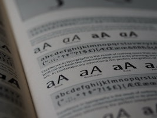

This is a normal paragraph. Just type. A blank line between paragraphs starts a new one.

You can make words **bold** by wrapping them in two asterisks, or *italic* with one asterisk on each side. Combine them for ***bold italic***.

Links look like this: [Green Smoke Studio on Behance](https://www.behance.net/greensmokestudio). Links to other websites open in a new tab automatically. Links within your own site start with a slash, like [the Work page](/work).

## Large heading (two hashes)

Use for a major section in a long article. In Playfair Display, like the page title.

### Pull quote (three hashes): a big, light statement that breaks up the text

Use to highlight a key line. The original articles put a line containing only ` ` above and below these for extra breathing room, as shown next.

 

### A pull quote with extra space above and below

 

#### Subheading (four hashes)

A softer, slightly faded subheading.

##### Small heading (five hashes)

Used for numbered points in the original articles, like "1. Better design."

###### Label (six hashes)

Small, faded capitals. Good for a kicker above a section.

> A quote from someone else (start the line with >). It gets a grey bar down the left.

A bulleted list:

- Start each line with a hyphen and a space
- One item per line
- Leave a blank line before and after the list

A numbered list:

1. Start each line with a number and a full stop
2. The numbers count themselves
3. Like the bullets, leave a blank line before and after

An image (put the file in /images/journal/ first):

A dividing line (three hyphens on their own line):

---

That's everything. If you want a style that isn't here, ask and it can be added.
